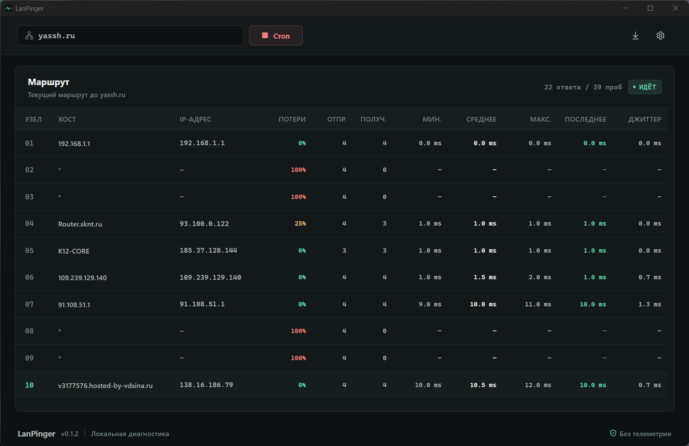

# LanPinger

LanPinger is a lightweight desktop app for monitoring network routes in real time.

---

## ⬇️ Download v1.1.4

|  Platform  |  Architecture  | Download                                                                                                   |
|:----------:|:--------------:|:-----------------------------------------------------------------------------------------------------------|
| 🪟 Windows |      x64       | [**Download**](https://github.com/megoRU/LanPinger/releases/download/1.1.4/LanPinger_1.1.4_x64-setup.exe)  |
|  🐧 Linux  |   x64 (DEB)    | [**Download**](https://github.com/megoRU/LanPinger/releases/download/1.1.4/LanPinger_1.1.4_amd64.deb)      |
|  🐧 Linux  |   x64 (RPM)    | [**Download**](https://github.com/megoRU/LanPinger/releases/download/1.1.4/LanPinger-1.1.4-x86_64.rpm)     |
|  🐧 Linux  | x64 (AppImage) | [**Download**](https://github.com/megoRU/LanPinger/releases/download/1.1.4/LanPinger_1.1.4_amd64.AppImage) |
|  🍎 macOS  |     ARM64      | [**Download**](https://github.com/megoRU/LanPinger/releases/download/1.1.4/LanPinger_1.1.4_aarch64.dmg)    |

---

## 🖼️ Screenshot

---

## 📄 License

This project is licensed under the [GNU General Public License v3.0](https://www.gnu.org/licenses/gpl-3.0.html).
